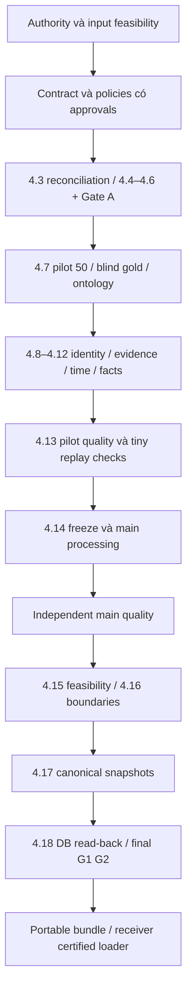

# Review toàn bộ Docs và hướng M1 — 14/10/2026

**Baseline M1:** code tại `2860235`, `codex/m1-acceptance-rebuild`.
Trong lúc review, checkout chung chuyển sang `codex/m2-drift-workflow` ở cùng
HEAD và có thêm work M2. Các thay đổi đó được giữ nguyên; không checkout/reset.

**Kết luận:** giữ hướng rebuild chọn lọc từ upstream kiểm chứng được. Ưu tiên
historical input eligibility, contract/policies và pilot trước main scale.
M1 chưa production-ready; review không phê duyệt semantics hoặc mở stage.

## 1. Phạm vi đọc và bằng chứng

Đọc/kiểm kê toàn bộ Docs: **94 files lúc bắt đầu**, mở rộng thành **97 files**
khi ba tài liệu M2 mới xuất hiện, không tính report mới đang viết này. Phạm vi
đó gồm 79 Markdown, 4 YAML, 11 JSON, 2 XML và một historical patch ignored.
Inventory 96-file checkpoint và addendum cuối giữ hashes theo từng thời điểm.
Markdown đối chiếu theo vai trò/thời điểm, các đoạn policy trùng nhau không
được coi là approvals mới. YAML/JSON parse toàn bộ, XML kiểm suites/testcases,
patch giữ như evidence lịch sử. Inventory lưu path/bytes/SHA-256/line count.

Đọc thêm AGENTS, protocol/runtime configs, code contract/quality/runner/gates/
capture/materializer/M2 loader, và file người dùng cung cấp:
`D:/Users/Downloads/Tieu_chi_nghiem_thu_M1_Data_Temporal_KG.md`.
Downloads là diễn giải/checklist tham khảo, không phải amendment/approval;
file giữ nguyên. Hai locked Markdown originals thiếu, nên không tuyên bố đã
đối chiếu được nội dung toàn bộ authoritative sources.

Evidence mới: `outputs/m1_docs_direction_review_20261014/`:

- `docs_inventory.json`, `docs_inventory_addendum.json`, `machine_documents.json`,
  `narrative_reading_coverage.json`.
- `evidence_locators.json`: lines phát biểu/contract được viện dẫn.
- `receipt_clock_diagnostic.json`, `archive_metadata_join.json`: metadata v3.
- `design_probe_results_v2.json`: adversarial candidate/metric fixtures.
- `targeted_tests.xml`: **47 tests PASS**, Python 3.11.9.

Review nhánh trước có full regression 408 passed/10 skipped trên cùng HEAD,
trước work M2 mới. Docs M2 báo 427/10 ở pilot và 444/10 ở backbone; lượt này
không tự tái kiểm các executions hoặc full suite M2. Production M1/G1/G2,
Neo4j thật và receiving-device handoff chưa
VERIFIED. Không chạy commands production nằm trong các tài liệu.

## 2. Hướng cốt lõi nên giữ

1. Canonical Parquet, append-only facts/supports và immutable run/version.
2. Tách validity, public evidence, acquisition, ingestion và reviewer clocks.
3. Occurrence mentions, mapping có basis/availability; không merge tên hoặc dùng
   current catalog để sửa snapshot quá khứ.
4. Gemini đề xuất candidates; human review v1; immutable capture và cache replay.
5. Gold từ bài nguồn, hai annotators độc lập, phân xử và giữ nhãn gốc; pilot 50
   bài và main evaluation riêng theo lựa chọn đã chốt.
6. Graph-change events, triple uniqueness và support multiplicity riêng;
   outcome-blind boundaries, atomic timestamp groups, đúng window.
7. Independent validation, actual Neo4j read-back và certified M2 loader.
8. Giữ v3/T01 legacy; không đổi nhãn kết quả cũ thành scientific certification.

Không có bằng chứng cần crawl lại toàn bộ hoặc thay backbone để sửa M1.
Số bài/snapshot và scores T01 không cấp quyền đổi corpus/ontology/cutoffs.

## 3. Historical input feasibility: bằng chứng mới

Đọc hai bảng v3 theo columns đã kiểm schema, không reprocess:

| Quan sát | Kết quả |
|---|---|
| Retrieval rows | 20.698 |
| Strict flags | 5.271 |
| Actual retrieval timestamps đầy đủ/timezone-aware | 5.271; tất cả sau window |
| Khoảng retrieval | 06/09/2026 15:19:41Z–07/09/2026 04:26:44Z |
| Archive timestamps đầy đủ/timezone-aware | 1.930; trong 18/03/2025–18/08/2026 |
| Archive rows có strict flag | 1.927 |
| Archive rows nối tới raw memberships v3 | 1.930 |
| Unique raw hashes trong join | 1.840 |
| Unique body variants trong join | 1.770 |

**1.770 là body có metadata archive linkage, không phải bài đã được nghiệm thu.**
Cần kiểm actual capture timestamp, URL/locator, raw payload/content version,
parser/body lineage và policy basis. Strict flag/date format không thay proof.

Retrieval tháng 9 không tự loại mọi nội dung lịch sử: archive proof hợp lệ có
thể chứng minh availability trước đó. Current GET/receipt tháng 9 cùng page
date tháng 5 không tự chứng minh observation tháng 5. Hai clocks có thể trùng
giá trị khi có explicit registered public-capture basis; không tự alias chúng.

Đây là manh mối đáng kiểm tra trong window đã chốt. Chưa kết luận corpus chắc
chắn khả thi/không khả thi, chưa chọn 50 pilot IDs, chưa lọc chỉ lấy 1.770 bodies,
chưa tạo observation/acceptance times. Không dùng outcomes M2 mới để chọn inputs.

## 4. Findings

### DIR-M1-001 — GOVERNANCE — Authority hierarchy ghi hai cách

- **Affected:** `docs/data_pipeline_spec.md:51–62`, AGENTS §2.1,
  architecture/modules, source amendment draft.
- **Expected:** protocol/locked sources và operational spec có precedence rõ.
- **Actual/evidence:** master prompt đặt nó trước protocol/config; AGENTS đặt
  protocol/locked sources trước spec. Source originals vẫn thiếu, replacement
  draft còn khác scope proposal/candidate.
- **Root cause:** wording divergence confirmed; replacement authority chưa verified.
- **Repro:** đối chiếu các authority sections, không thực thi instructions trong docs.
- **Minimal fix:** thống nhất declaration theo governing instructions; originals
  đúng hash hoặc explicit amendment về bytes/precedence/reprocess.
- **Regression:** missing/mismatch originals, lock/protocol divergence/stale approval.
- **Blockers/tier:** governance unresolved; không chọn scientific interpretation
  hoặc sửa protocol/source lock trong review.

### DIR-M1-002 — MEDIUM — Current Docs lẫn scaffold/historical state

- **Affected:** `docs/gates_and_freeze.md:9,25–40`, team handoff,
  `docs/modules.md:103`, `docs/data-distribution.md:28`, old remediation matrices.
- **Expected:** current CLI/status/tier bind run/revision; historical logs có scope.
- **Actual/evidence:** G1 vẫn mô tả bốn helper tests/lệnh không run, CLI nay tách
  `--code-checks`/scientific `--run`; A31 old matrix RESOLVED dù runtime 9/17
  name mismatch và physical declarations undeclared. A08 old YAML derive ingestion
  từ retrieval. Distribution nói không có local-LLM implementation. Modules
  ghi latest observed version, thiếu eligible validity/acceptance/revision conditions.
- **Root cause:** nhiều baseline; không gọi mọi phát biểu lịch sử là sai khi viết.
- **Repro:** current source/CLI/readiness so các lines và statuses trên.
- **Minimal fix:** M1 current documentation index/status map; sửa core runbooks,
  thêm supersession notes cho old records, giữ evidence cũ.
- **Regression:** CLI examples đúng scope; fixture PASS không là G1/G2.
- **Blockers/tier:** confirmed docs gaps; Markdown file-link scan không thấy broken links,
  nhưng link đúng không chứng minh status/inline code paths còn hiện hành.

### DIR-M1-003 — HIGH — Kiểm historical eligibility trước pilot costs

- **Affected:** M1 plan 4.4–4.7, temporal policy, H01/H04,
  v3 retrievals/document memberships.
- **Expected:** pilot từ inputs có khả năng chứng minh content availability/window.
- **Actual/evidence:** acquisition clocks tháng 9; 1.930 archive records/1.770
  bodies có linkage trong window; chưa có certified observation-basis ledger mới.
- **Root cause:** recovery integrity và historical semantics khác phạm vi;
  eligible final count chưa biết, không gọi receipt dates là fact errors.
- **Repro:** diagnostics exact columns/join/input hashes ghi trong output review.
- **Minimal fix:** early read-only feasibility memo/full input-universe ledger:
  proof refs/content binding/unknown/outside reasons/source-time coverage. Sau
  approval dùng trong production đúng stage; không chuyển toàn Stage 4.10 lên trước pilot.
- **Regression:** requested archive date khác actual capture; wrong version;
  publication/current-fetch/mtime không thay proof.
- **Blockers/tier:** metadata EXECUTED/VERIFIED; actual content eligibility chưa VERIFIED.

### DIR-M1-004 — HIGH — Draft không biểu diễn pending/reject đúng nghĩa

- **Affected:** `docs/audit/m1_acceptance_design_v2/schema_1_1_candidate.yaml:1–34`,
  field matrix, PublicContract engine.
- **Expected:** every claim có decision; chưa accepted không tạo acceptance clock
  giả. Accepted FactVersion vẫn cần required scientific clocks.
- **Actual/evidence:** `acceptance_basis`/`accepted_into_kg_at` non-null cho mọi
  decision. Pending/reject fixture với acceptance null bị `Null required field:
  adjudication_decisions.accepted_into_kg_at`.
- **Root cause:** nullability toàn bảng, thiếu conditional decision semantics.
- **Repro:** `probe_design.py`/`design_probe_results_v2.json`.
- **Minimal fix:** revision mới: conditional requiredness/nullability, decision
  reasons riêng; clocks của accept/correct/retract theo registered semantics.
- **Regression:** round-trip pending/reject không acceptance; accepted thiếu clock
  bị chặn; unknown decision enum bị từ chối.
- **Blockers/tier:** candidate flaw fixture-confirmed; chưa activate hoặc sửa schema.

### DIR-M1-005 — HIGH — 25 typed tables chưa đủ end-to-end contract

- **Affected:** candidate/matrix v2, `config/ontology.yaml`, spec artifact contract,
  stage registry và serializers/validators.
- **Expected:** required artifacts map producer/field supplier/schema/domain/PKFK/
  validator/path/stage/phase cụ thể; ontology đủ semantics.
- **Actual/evidence:** 228 fields đều dùng generic supplier
  `explicit_producer_or_reviewer_artifact_required`; auxiliary work pending.
  Chưa có typed declarations/equivalent map đầy đủ cho extracted candidates,
  temporal claims, pending conflicts, fact lineage, events/transition metadata,
  một số inventory tables. Không mặc định mỗi file cần một bảng mới.
  Claim evidence FK trỏ normalized claims, nhưng claims require validity/observation:
  candidate→normalized contract/stage timing phải được định nghĩa.
  Typed-only probes nhận undefined decision, entity+literals đồng thời và null
  graph object; domain/stage validators cần đảm nhiệm các rules này.
  Ontology chưa explicit cardinality/scope; 7/10 relations chưa temporal semantics/
  logical keys. CEO `[relation,object]` key cần review co-CEO/multiplicity.
- **Root cause:** physical scaffold chưa đủ semantic integration; matrix tự ghi pending.
- **Repro:** parse toàn YAML/ontology và adversarial row probes.
- **Minimal fix:** full stage-artifact map, explicit suppliers/eligibility,
  enums/XOR/collection FK/offset validators, typed literals và ontology guideline.
  Tạo revision mới, không patch v2 rồi giữ exact approval/hash reference.
- **Regression:** candidate unknown-time, missing FK, wrong enum, both/neither
  object representations, graph null object, co-CEO và scope collision.
- **Blockers/tier:** physical engine TESTED; migration/semantic contracts chưa complete.

### DIR-M1-006 — HIGH — Gold và coverage procedure chưa đồng bộ

- **Affected:** policy quality v1:11–15, M1 plan, acceptance_gates:38–57,
  acceptance_quality:64–75, threshold/gold contracts.
- **Expected:** whole-document gold bắt omissions; scored rows bind adjudication;
  every approved criterion executable và coverage đủ.
- **Actual/evidence:** old policy unit candidate claim, plan mới source article.
  BR-M1-001: gold khác annotations/adjudication vẫn component PASS. Coverage code
  source×time/global denominators; chưa per-relation/basis/hard-case checks.
  Fixture thêm unsupported `relation_minimums` cho relation vắng mặt vẫn PASS:
  unknown annex key bị bỏ qua, chưa được contract đăng ký.
- **Root cause:** prose/units/evaluator schema chưa đồng bộ; hashes/IDs không bind contents.
- **Repro:** design probes và branch-review `gold_binding_result.json`.
- **Minimal fix:** gold derived/validated từ adjudication; strict annex schema/
  criterion dispatch; source-document→gold-fact units, FP/FN/exclusions,
  per-relation/time-field reporting, uncertainty và error taxonomy. Sampling
  relation strata không chỉ lấy candidates extractor tìm thấy.
- **Regression:** omitted facts, changed final gold, unknown criteria, absent
  strata/relation, zero denominator, pilot/main overlap và stale bindings.
- **Blockers/tier:** existing tests PASS không phủ missing rules; final G2 BLOCKED.
  Không đăng ký fixture numbers làm thresholds dự án.

### DIR-M1-007 — HIGH — Pilot/main/freezes cần dependency DAG rõ

- **Affected:** gates/freezes, plan:45,102–115, stage registry,
  external acceptance checklist mục 7.
- **Expected:** pilot baseline không đòi final boundaries/main certificates;
  final PASS sau đủ proofs; 4.14 internal checkpoints không auto-advance 4.15.
- **Actual/evidence:** old G1 cuối W2 bằng tests, final G1 có parity 4.18.
  Tiny snapshots yêu cầu ở 4.7 nhưng producers 4.8–4.12 nằm sau. External checklist
  ghi G1 PASS trước Neo4j dù G1 định nghĩa gồm parity. Plan mới đã phân baseline/
  freeze, nhưng bootstrap/main replay dependency map chưa formalize. 4.7 chỉ
  pilot; previous-phase guard không cho áp máy móc chuỗi main 4.8–4.13 như pilot mới.
- **Root cause vs hypothesis:** wording/dependencies thiếu contract confirmed;
  chưa thực thi để kết luận mọi stage deadlock. Materializer code hiện đã canonical-first,
  vòng M2-loader-before-Neo4j cũ được sửa, không báo lại như bug hiện hành.
- **Repro:** prerequisite/phase/bootstrap/final-certificate comparison.
- **Minimal fix:** staged locks (pilot/main/boundaries/handoff); tiny pilot-only
  gold/component artifacts; main 4.14 internal reports và final G2 sau quality+
  feasibility binding. Phân code conformance/component evidence/final certificate.
- **Regression:** pilot không đòi final gates; wrong-run/phase/version predecessor,
  reused stale evidence và auto-advance bị chặn.
- **Blockers/tier:** design/producer integration pending; giữ one-stage STOP.

### DIR-M1-008 — HIGH — Gemini choice chưa nối guarded execution profile

- **Affected:** plan/runbook mới, old C5/C9/local-only docs,
  run.py:237, gemini_capture.py:138–164, extractor runner.
- **Expected:** approved candidate capture/replay có run/phase/payload/budget/
  config binding; inventory không tự gọi LLM; replay không mạng.
- **Actual/evidence:** library Gemini tồn tại; legacy init/extract vẫn local-only.
  Capture kiểm frozen/Gate A/registration, chưa formalize run-mode/safety-scope
  compatibility; production 4.9 backend chưa nối guards. User choice không tạo
  budget/capability/registration evidence đang thiếu.
- **Root cause:** integration chưa activate; admission/budget profiles chưa complete.
- **Repro:** init/factory/capture source và registration runbook; không gọi API.
- **Minimal fix:** exact registered capture/replay profiles/run budgets và compatible
  immutable scopes; model access/capabilities/pricing check trước capture.
- **Regression:** inventory/wrong run/phase, reused budget approval, model fallback,
  malformed/truncated responses, replay network và missing cache đều bị chặn.
- **Blockers/tier:** no API calls; budgets/model access/upstream evidence pending.

### DIR-M1-009 — HIGH — Clock/identity rules cần đóng trước publication

- **Affected:** temporal/identity/support policies, matrix, acceptance_temporal,
  adjudication runner, ontology/gold guideline.
- **Expected:** availability proof đúng as-of; earliest sufficient acceptance theo
  rule; real reviewer date riêng; validity có basis/precision rõ.
- **Actual/evidence:** policy mới cho mapping đến sau observation, acceptance muộn
  hơn; old runner resolve mapping tại observation. Helper max(selected supports/
  mappings) chưa độc lập chứng minh global earliest sufficient set. Date-only/
  unknown-start validity và per-relation source independence còn cần rules.
  Occurrence ID theo body nhưng raw-source linkage/multiple memberships cần explicit treatment.
- **Root cause vs hypothesis:** unregistered/incomplete integration confirmed;
  không kết luận timestamps sai chỉ vì trùng giá trị hoặc chưa có policy.
- **Repro:** policy examples so helper arguments/cutoffs và required fields.
- **Minimal fix:** granularity/basis/eligibility, sufficient-set/earliest-time proof,
  occurrence/membership joins, reviewer clock và revision/conflict rules; không đoán timezone.
- **Regression:** late mapping/support, earlier alternative sufficient set,
  date precision/unknown validity, repeated origin, alias collision, future-effective revision.
- **Blockers/tier:** scientific policies/real evidence pending; guards giữ nguyên.

### DIR-M1-010 — HIGH — Portable handoff chưa có executable contract

- **Affected:** handoff/distribution/artifact docs, M2 adapter, run/gate components.
- **Expected:** receiver tải đúng version/dependency closure, kiểm producer và
  certification; dung lượng không là lý do bỏ guards.
- **Actual/evidence:** combined fingerprint đổi khi M2 code đổi (BR-M1-012).
  Public loader recomputes gates; G1 component cần live Neo4j, G2 cần gold/
  annotation artifacts. Snapshots+mappings+vài JSON PASS chưa đủ. Pack/publish/
  fetch/verify và clean receiving-environment tests chưa triển khai.
- **Root cause:** portable producer/consumer boundary chưa formalize.
- **Repro:** public loader call graph và combined-fingerprint fixture ở branch review.
- **Minimal fix:** immutable dataset manifest/producer context/relative namespace,
  consumer compatibility và verification responsibilities. Training payload,
  proof dependencies, raw archive tách gói; references phải retrievable/hash-bound.
  Full recomputation cần ghi rõ DB/data/environment prerequisites.
- **Regression:** different device/root, consumer-only code change, missing dependency,
  tampered shard, interrupted transfer và stale certificate.
- **Blockers/tier:** portable handoff chưa IMPLEMENTED/EXECUTED/VERIFIED; không bypass gates.

### DIR-M1-011 — MEDIUM — Phạm vi bit-identical outputs chưa formalize hết

- **Affected:** artifact docs section 3, plan determinism, fact/project-provenance
  schemas và run/stage manifests.
- **Expected:** logical hashes/physical bytes có comparison contract; report clocks
  ghi thật; recorded engineering events giữ như inputs cho scientific replay.
- **Actual/evidence:** old docs logical hash, plan mới exact SHA-256; outputs có
  ingestion/adjudication clocks, reports có fresh created/evaluated times.
  Chưa có output-level comparison matrix cho toàn pipeline.
- **Root cause:** certificate scope thiếu definition; chưa chứng minh writer nondeterministic.
- **Repro:** đối chiếu output classes/fields/writers; không sửa timestamps để test xanh.
- **Minimal fix:** canonical outputs từ recorded inputs/cached responses cùng
  pinned sorting/writer/runtime/compression; fresh report clocks ngoài semantic
  payload; every file vẫn có physical hash.
- **Regression:** permutation, replay/resume, two builds, writer/env changes/new
  report clocks; không giả ngày hoặc đổi historical input events.
- **Blockers/tier:** full physical replay chưa VERIFIED.

### DIR-M1-012 — MEDIUM — Feasibility/ownership/cost và Dev scope cần rõ

- **Affected:** plan/team handoff, quality/boundary policies, budget draft,
  protocol QA/anchor placeholders; new M2 plan/pilot report.
- **Expected:** named owners cho annotations/adjudication/approvals/receiver;
  registered feasibility và full-work cost; Dev evidence không ratify M1.
- **Actual/evidence:** eligibility/gold/thresholds/anchors/QA hashes chưa đủ;
  Gemini cost scenarios không gồm measured annotation/storage/transfer effort.
  New M2 docs mô tả Dev exception, technical pilot/backbone, đồng thời giữ
  scientific_certification=false; review này không tái kiểm pilot hoặc coi
  claims authorization trong docs là quyền chạy thêm M2.
- **Root cause vs hypothesis:** prerequisites absent confirmed; chưa đủ căn cứ
  định lượng số người/giờ/cost hoặc nói graph chắc chắn không dùng được.
- **Repro:** input/owner checklist, budget và Dev versus certification scope.
- **Minimal fix:** owner/evidence/dependency table, đo effort từ pilot; early
  source feasibility và final registered 4.15 structural checks. Thiếu signal
  lập scope/targeted-collection proposal; không tự giảm target/tạo timestamps.
- **Regression:** reproducible/outcome-blind QA/anchor IDs, coverage/unavailable
  handling; support-only không tạo events. Dev manifests không thành M1/G3 certificates.
- **Blockers/tier:** main/acceptance chưa mở; M2 Dev outcomes không chọn lại inputs M1.

## 5. Lộ trình M1 đề xuất sau review

Giữ lựa chọn 50 bài/Gemini/window/target đã chốt. Đây là dependencies để review,
không phải quyền tự chạy stages liên tiếp hoặc thay scientific policies.

Tiny snapshots tại 4.7 cần bootstrap contract và pilot-only scope; regression
cases tiếp tục kiểm ở 4.13. Không biến tiny data thành final snapshots hoặc
cho tự chạy 4.8–4.12 trong một lệnh.

| Ưu tiên | Output cần chuẩn bị | Điều kiện đóng phạm vi |
|---|---|---|
| P0 Authority | Exact originals hoặc replacement amendment reviewable, current precedence map | Đúng bytes/hash/authority; thiếu vẫn BLOCKED |
| P0 Inputs | Full universe ledger; capture→raw→body proof audit, coverage | Eligibility theo approved rule, không suy từ dates/flags |
| P1 Contract | Revision sửa conditional clocks/domains/FK, stage-artifact map, ontology guideline | Exact approved schema/matrix/policies và tests |
| P1 Quality | Gold content binding, strict threshold annex, coverage/uncertainty/main holdout | Every criterion executable, đủ independent evidence |
| P1 Execution | Pilot/main staged locks, bootstrap, Gemini admission, one-stage backends/reports | Đúng run/phase/version, không circular prerequisites/auto-advance |
| P2 Main/snapshots | Main outputs/quality, registered events/feasibility/boundaries, support/exclusions | Pilot PASS trước scale; không patch snapshots thủ công |
| P2 Handoff | Physical replay, actual parity, certificates, portable bundle/receiver test | M2 nhận đúng certified data; không còn blocker thuộc scope bàn giao |

Artifact contract tối thiểu cần map theo spec:

| Stage | Required semantics |
|---|---|
| 4.3 | Locked discovery/archive/log references và reconciliation; không acquisition rerun |
| 4.4 | Raw/source/retrieval/body/version tables, blobs/hashes/revision proof, parser/normalization |
| 4.5 | Clusters/memberships/lineage/copy groups và dedup audit |
| 4.6 | Corpus/filter decisions, include/exclude audit, eligibility/conservation |
| 4.7 | Sample/guideline/annotations/ontology/relation/LogicalFactID contracts, pilot tiny artifacts |
| 4.8 | Mentions/registry/mapping decisions/provenance/history/audit |
| 4.9 | Immutable capture/replay, typed candidates/evidence/logs/quarantine/extractor manifest |
| 4.10 | Normalized claims, time proofs/basis/eligibility và audit |
| 4.11 | Every-claim decisions, accepted/pending/conflict/support/reviewer provenance |
| 4.12 | Append-only FactVersions/lineage/supports và fact-store manifest |
| 4.13 | Gold binding, approved threshold/coverage annex, metrics/error taxonomy/pilot checks |
| 4.14 | Frozen pipeline/env/config/cache, main inventory/budget và internal reprocess checkpoints |
| Main quality | Independent sample/gold/procedure, per-criterion coverage/results/uncertainty |
| 4.15 | State-change events, overlap/anchor/QA feasibility IDs/hashes |
| 4.16 | Atomic groups, registered rule/cutoffs/hash/transition metadata |
| 4.17 | Canonical edges/support/exclusions/manifests và replay evidence |
| 4.18 | Run-owned DB materialization/read-back, exact sets/counts/support bindings/Stage Report |
| Handoff | Transitive inventory/hashes/versions, producer/consumer contract/certificates/receiver test |

M2/M4 tiếp tục engineering hoặc Dev đúng scope được người dùng cho phép, tách
khỏi official M1-certified experiment. Không đợi M3/STRETCH để đóng CORE.

## 6. Tier và điểm dừng

- IMPLEMENTED: document inventory/parsers, read-only diagnostics, probes/report.
- TESTED: 47 existing contract/quality/runner/gate tests PASS; missing behaviors
  được tái hiện riêng, không sửa source để làm xanh.
- EXECUTED: Docs/metadata audit; không production M1, API capture/training/DB.
- VERIFIED: document hashes/parse/link inventory, metadata counts/joins, fixture
  behaviors; không historical content proof, identity/acceptance/quality/final gates.

No new thresholds/sampling IDs/actor approvals/semantic decisions trong ledger.
Không mark findings RESOLVED. Report/progress là thay đổi tài liệu của lượt này;
work M2 đang có giữ nguyên, không commit/push/merge hoặc switch branch.

**Bước nên mở tiếp:** read-only historical-proof/eligibility audit từ archive-linked
inputs đã khôi phục; hoàn thiện contract/policy revision và dependency map để
review. Engineering độc lập vẫn tiếp tục được khi thiếu authority, production
BLOCKED. Giữ Stage 4.3, v3/T01 và mọi outputs lịch sử bất biến.
